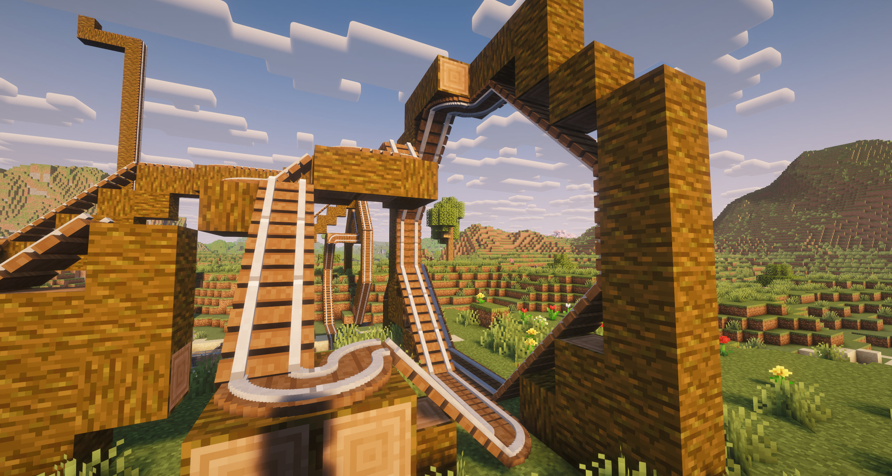
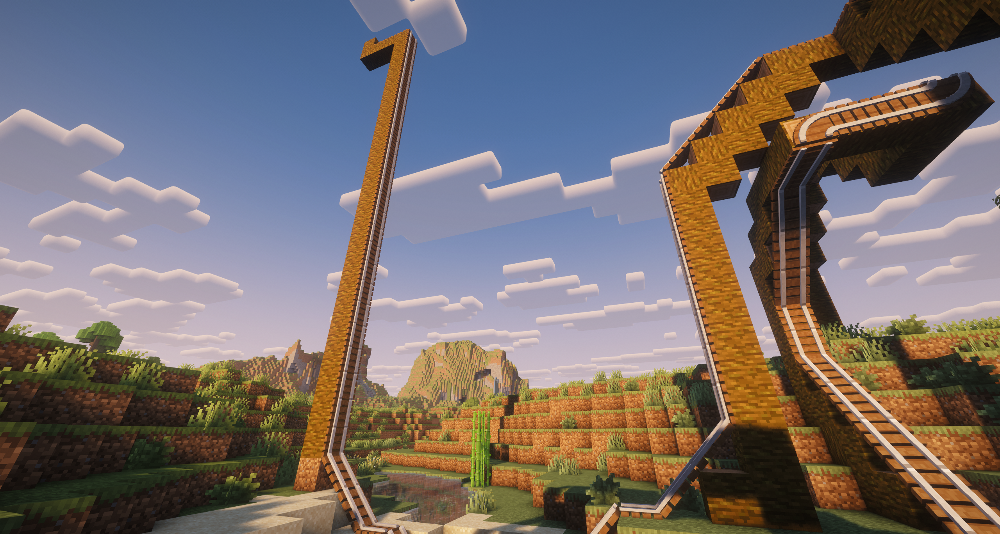
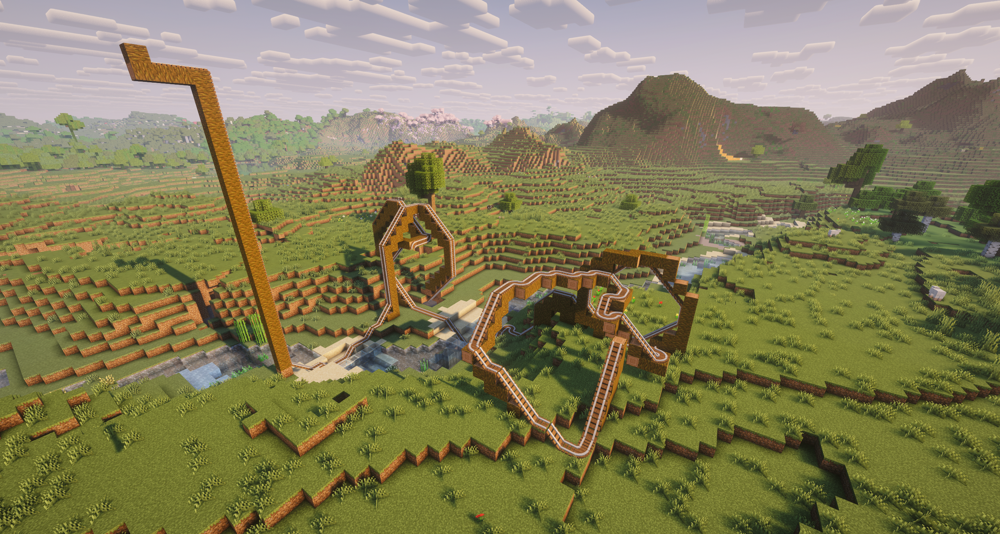

# Roller Coaster

A Fabric mod for Minecraft that adds a real roller coaster: universal track that can be
placed on floors, walls and ceilings, and a cart that rides it – straight up vertical walls
and upside down along the underside of blocks.


## Features

- **Track on any surface** – floor, ceiling (underside of a block) and walls, both vertical
  and horizontal.
- **Left and right turns** – track connects automatically like vanilla rails; place a track
  beside the end of a line and the end turns into a 90° curve. Works on floors, ceilings and walls.
- **Slopes** – lay track on a staircase of blocks and the lower track turns into a ramp.
- **Surface transitions** – the cart rides on its own from floor to wall, wall to ceiling,
  around the outer edge of a block, and from the top of a slope straight onto a vertical wall.
- **Coaster cart** – with a passenger it accelerates by itself; gravity slows it down uphill
  and speeds it up downhill. If it can't make it up a wall, it rolls back.
- **Upside-down riding** – on the ceiling the cart is drawn wheels-up and the rider's camera
  smoothly rolls 180°.
- **Quick building** – click an existing track with a track item to extend it in the
  direction you're looking.
- **Shader compatible** – works with Iris and shader packs such as Complementary.
- English and Polish translations.

 
 
 

## Requirements

| Component | Version |
|---|---|
| Minecraft (Java Edition) | 26.3 |
| Fabric Loader | 0.19.5 or newer (built against 0.20.1) |
| Fabric API | 0.165.0+26.3 or a newer build for 26.3 |
| Java | 25 |

Optional: Iris (with or without a shader pack) and Sodium.

## Installation

1. Install the [Fabric Loader](https://fabricmc.net/use/installer/) for Minecraft 26.3.
2. Download [Fabric API](https://modrinth.com/mod/fabric-api) for 26.3.
3. Copy `rollercoaster-<version>.jar` and the Fabric API jar into the `mods` folder of your
   Fabric profile (by default `~/.minecraft/mods` on Linux, `%APPDATA%\.minecraft\mods` on Windows).
4. Start Minecraft with the Fabric profile.

When updating, remove the old `rollercoaster-*.jar` from `mods` first – only one version may
be installed at a time.

## Items and crafting

Both items are also in the creative tab **Tools & Utilities**.

| Item | Recipe | Result |
|---|---|---|
| Coaster Track | `I I` / `ISI` / `I I` (I = iron ingot, S = stick) | 16 × Coaster Track |
| Coaster Cart | `IRI` / `III` (I = iron ingot, R = redstone dust) | 1 × Coaster Cart |

## Building track

### Placing track

| Where | How |
|---|---|
| Floor | Click the top of a block. The rails run in the direction you're facing. |
| Ceiling (upside down) | Click the underside of a block. The rails run in the direction you're facing. |
| Wall, vertical | Click the side of a block. The track runs up and down. |
| Wall, horizontal | Click the side of a block while holding **Shift**. |
| Extend a line | Click an existing track. The next piece appears beyond the end you're looking at: straight on, up a wall in front of it, or over the edge of a block. Hold **Shift** to disable this. |

Track needs a solid block behind it and can be walked through.

### Turns (left / right)

Track connects to its neighbours automatically. Lay a line, then place a track **beside the
last piece** of the line (click the ground next to it, not the track itself). The last piece
becomes a 90° curve and the new piece starts the branch.

```
  top view
  =        ← line running north
  =
  ╰ N      ← N = new track; the last piece of the line becomes a curve
```

Only the end of a line bends – a piece that already has neighbours on both sides stays straight.

### Slopes

Build a staircase of blocks (each step one block higher and one block further) and put a track
on every step. The track on the lower step turns into a ramp leading to the higher one. The
order in which you place the pieces doesn't matter. Slopes also work on ceilings.

```
  side view
          = =      ← track on the top step
        / #
      / # #        ← lower tracks become slopes
  = = # # #
```

### Floor → wall → ceiling

```
  side view

        S S S S              S = ceiling block
      ← = = = |              = = track on the ceiling (placed on the underside of S)
              |W             | = vertical track on wall W
              |W             W = wall block
  = = = = = = /W             / = floor track next to the wall (becomes a short slope)
  # # # # # # #W
```

- **Floor → wall**: the last floor track lies right next to the wall; the first wall track goes
  **one block higher**, on the wall above it. The floor track turns into a short slope so the
  cart climbs onto the wall smoothly. The wall must be at least 2 blocks high.
  Tip: click the last floor track while looking at the wall and the wall track is placed for you.
- **Slope → wall**: put a track on the last step right next to the wall and a vertical track on
  the wall above it – the step track becomes a slope that leads straight onto the wall.
- **Wall → ceiling**: the topmost wall track lies right under the ceiling; the first ceiling
  track goes on the underside of the block **next to it**, on the side the cart should continue.
- **Outer corner** (e.g. from the floor down the side of a block): put the track on the side of
  the block, right below the edge.

## Riding

- Click a track with the cart to place it; it faces the direction you're looking.
- Right-click the cart to get in, press **Shift** to get out.
- With a passenger the cart accelerates on its own. Gravity slows it down uphill and speeds it
  up downhill; if it doesn't reach the top of a wall it rolls back.
- At the end of the track the cart stops.
- Hit the cart to pick it up. If the track under it is removed, the cart drops as an item.

## Building from source

You need **JDK 25** (`java -version`) and an internet connection for the first build
(Gradle downloads Minecraft, Fabric Loom and Fabric API).

```bash
cd ~/Documents/MinecraftProjects/Mod1
chmod +x gradlew
./gradlew build        # result: build/libs/rollercoaster-<version>.jar
./gradlew runClient    # starts a development Minecraft with the mod loaded
```

Use `build/libs/rollercoaster-<version>.jar` – not the `-sources.jar`.

### Version numbers

The version has the form `<mod_version>.<build number>`, e.g. `0.2.4`.

- `mod_version` (the first two parts) is set in `gradle.properties`.
- The build number is stored in `build-number.txt`. Every successful `./gradlew build`
  uses that number and then increases it by 1, so each build gets a new file name.
- To start a new series, e.g. 0.3.1, set `mod_version=0.3` and put `1` in `build-number.txt`.

Library versions (Loader, Loom, Fabric API) are also in `gradle.properties`;
current numbers are listed at https://fabricmc.net/develop.

## Project structure

| File | Purpose |
|---|---|
| `block/CoasterTrackBlock.java` | Track block: attachment side, rail axis, shape; automatic curves and slopes |
| `block/TrackShape.java` | Track shape: straight, one of four curves, or a slope |
| `block/TrackGeometry.java` | Ride line inside a block (straight / arc / slope) and finding the next track |
| `item/CoasterTrackItem.java` | Placing track and extending a line by clicking a track |
| `item/CoasterCartItem.java` | Placing the cart on a track |
| `entity/CoasterCartEntity.java` | Cart: physics along the track, passenger, saving |
| `client/render/CoasterCartRenderer.java` | Draws the cart rotated to match the track |
| `client/mixin/CameraMixin.java` + `CameraRoll.java` | Upside-down camera roll |

Java sources are in `src/main/java/pl/tomek/rollercoaster` (shared) and
`src/client/java/pl/tomek/rollercoaster` (client only).

## Known limitations

- On curves and slopes the cart model turns in one step instead of smoothly following the arc
  or tilting with the slope (the ride path itself is smooth).
- The cart is drawn from simple coloured boxes.
- In third-person view the player model is not flipped on the ceiling – only the camera is.
- On the ceiling, horizontal mouse look is inverted (a side effect of the camera roll).
- No speed control (W/S) yet – this needs a network packet and is planned.
- Track placed with older versions may need to be placed again after updating.

## License

CC0-1.0 – see [LICENSE](LICENSE).
